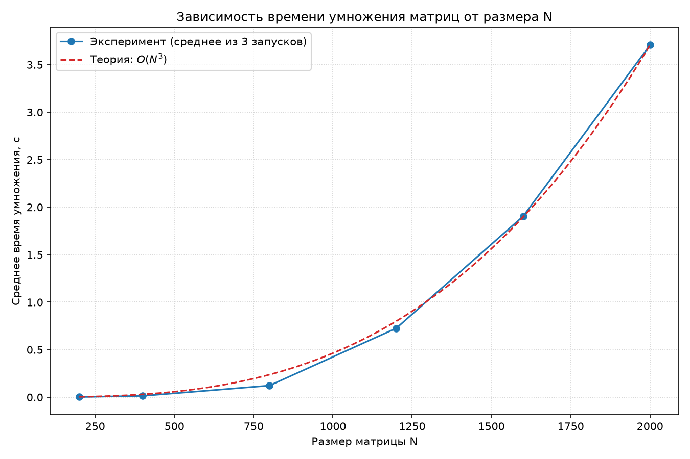

# parallel-programming
# Лабораторные работы по параллельному программированию

## Лабораторная работа №1. Умножение квадратных матриц

**Выполнила:** Павлова Татьяна, группа 6214-100503D

---
## Постановка задачи
Написать программу на C++ для перемножения двух квадратных матриц.
- Матрицы читаются из файлов
- Результат сохраняется в файл
- Замеряется время и объём задачи
- Верификация через Python + NumPy

## Реализация
- **Язык:** C++ 
- **Умножение:** тройной цикл с порядком `i-k-j` для лучшей работы с кэшем (последовательный доступ к памяти).
- **Замер времени:** `std::chrono::high_resolution_clock` (замеряется только само умножение, без учета генерации и записи файлов).
- **Оптимизация I/O:** Запись матриц в файлы выполняется только при `N <= 200`, чтобы дисковые операции не искажали результаты замеров на больших размерах.
- **Верификация:** Python + NumPy (сравнение с эталонным результатом).

## Структура проекта

```text
Lab1/
├── lab1.cpp             # Основная программа на C++
├── run_experiments.py   # Скрипт для серии экспериментов (3 запуска на N)
├── plot_results.py      # Скрипт для построения графика t(N)
├── verify.py            # Скрипт верификации через NumPy
├── times.csv            # Таблица с результатами экспериментов
├── time_vs_N.png        # График зависимости времени от N
├── matrixA.txt          # Пример исходной матрицы A (N = 200)
├── matrixB.txt          # Пример исходной матрицы B (N = 200)
└── result.txt           # Пример результата умножения (N = 200)
```
## Верификация
```text
============================================================
ВЕРИФИКАЦИЯ РЕЗУЛЬТАТА УМНОЖЕНИЯ МАТРИЦ
============================================================
Размеры: A = (200, 200), B = (200, 200), C = (200, 200)
------------------------------------------------------------
N                       : 200
Максимальный элемент |A|: 1.000000e+00
Максимальный элемент |B|: 1.000000e+00
Максимальный элемент |C|: 6.260918e+01
------------------------------------------------------------
Макс. абсолютная погрешность : 1.278977e-13
Макс. относительная погрешность: 2.529484e-15
Ожидаемый порядок (машинный):  ~ 2.780406e-11
------------------------------------------------------------
РЕЗУЛЬТАТ: ВЕРИФИКАЦИЯ ПРОЙДЕНА ✅
C++ и NumPy дают согласованный результат в пределах машинной точности.
```

## Результаты экспериментов
| N | Время (сек) | Объём задачи (N³) |
|---:|---:|---:|
| 200 | 0.0613 | 8 000 000 | 
| 400 | 0.5809 | 64 000 000 |
| 800 | 6.4368 | 512 000 000 |
| 1200 | 14.7197 | 1 728 000 000 |
| 1600 | 35.4591 | 4 096 000 000 |
| 2000 | 69.0915 | 8 000 000 000 |

## График

На графике показана зависимость времени выполнения от размера матрицы N.
Синяя линия — эксперимент, красная пунктирная — теоретическая O(N³).

## Выводы

1. **Сложность O(N³)** — время растёт кубически с размером матрицы.
2. **Малые N** (200, 400) — очень быстро (меньше секунды), матрицы помещаются в кэш.
3. **Большие N** (1600, 2000) — время растёт быстрее теоретического O(N³) из-за промахов кэша.
4. **Верификация через NumPy** — максимальная ошибка ~10⁻¹⁵, что соответствует машинной точности `double`.
5. **Экспериментальные точки** - общая тенденция  теоритической и экспериментальной кривых совпадает.

## Примечание

В репозитории лежат примеры входных матриц для N=200.
